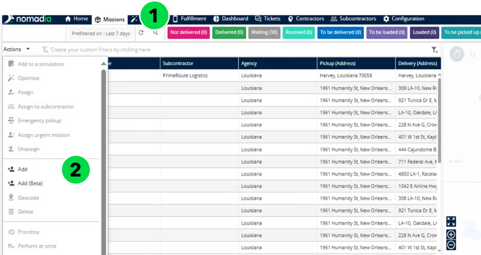

# Dropshippingmissies

Drop-shippingmissies vereenvoudigen de leveringsoperaties doordat vervoerders pakketten rechtstreeks van leveranciers naar eindklanten kunnen bezorgen, zonder terug te keren naar het agentschap. Deze methode verbetert de efficiëntie en is vooral geschikt voor logistieke scenario’s waarin rechtstreekse levering praktischer is dan traditionele modellen zoals cross-docking.

Om een drop-shippingmissie te creëren, moeten gebruikers (opdrachtgevers, vervoerders of onderaannemers) deze stappen volgen

1. Open de Nomadia Delivery-applicatie en ga naar het **Missies** tabblad.
2. Klik op de **Actiemenu** en selecteer **Toevoegen**.

<figure><figcaption></figcaption></figure>

3. Kies in de vervolgkeuzelijst Mission Type **Drop-Shipping.**

<figure><figcaption></figcaption></figure>

4. Selecteer in de vervolgkeuzelijst Contractor Identifier de **opdrachtnemer** die aan de missie is gekoppeld

<figure><figcaption></figcaption></figure>

* Voor drop-shippingmissies wordt het adres van de opdrachtgever (uit de configuratie van de opdrachtgever) automatisch gebruikt als standaard ophaaladres.

<figure><figcaption></figcaption></figure>

5. Selecteer de **Agentschap** van waaruit de bezorgers hun ronde zullen beginnen.

<figure><figcaption></figcaption></figure>

6. Klik op **Volgende**.

<figure><figcaption></figcaption></figure>

7. Het systeem toont standaard het adres van de opdrachtgever als ophaallocatie

<figure><figcaption></figcaption></figure>

* Klik indien nodig op de **Bewerken** knop naast het adresveld om een ander ophaaladres in te stellen.

<figure><figcaption></figcaption></figure>

8. Klik op **Volgende** om verder te gaan.

<figure><figcaption></figcaption></figure>

9. Voer de **bezorgadres** van de eindklant in de adressectie.

<figure><figcaption></figcaption></figure>

10. Klik op **Toevoegen** om de drop-shippingmissie te creëren.

<figure><figcaption></figcaption></figure>

Zodra dit is voltooid, wordt er een nieuwe missie van het type Drop-Shipping toegevoegd aan het leveringsbeheersysteem.

<figure><figcaption></figcaption></figure>

Volg deze stappen om een ronde voor een drop-shippingmissie te creëren Drop-shippingmissies worden uitsluitend beheerd via de optimalisatie-engine om nauwkeurigheid en strikte naleving van de leveringsketen te waarborgen. Handmatige routeplanning is beperkt om de integriteit van de workflow te behouden.

Leveringen zijn alleen toegestaan nadat alle ophalingen zijn voltooid, om verstoringen of fouten te voorkomen

1. Selecteer de door u aangemaakte missies, open het menu ‘**Acties**’, en kies ‘**Optimaliseer**’ om een batchoptimalisatie uit te voeren.

<figure><figcaption></figcaption></figure>

2. Bepaal de optimalisatie-scope door het datumbereik, het team en de voertuigen te selecteren en klik vervolgens op ‘**Optimaliseer**’.

<figure><figcaption></figcaption></figure>

3. Wanneer u tevreden bent met de resultaten, klik op ‘**Stop en bekijk het resultaat**’.

<figure><figcaption></figcaption></figure>

4. De optimalisatieresultaten worden weergegeven. Klik op ‘**Toon de simulatie**’ om de resultaten te analyseren.

<figure><figcaption></figcaption></figure>

5. Of klik op ‘**Routes valideren**’ om de resultaten rechtstreeks te publiceren zonder ze te controleren.
6. In het paneel ‘**Leveringen**’, zet de applicatie alle nummers van leveringsmissies vooraf met ‘**DROP**’ om ophaal- en aflevergebeurtenissen te onderscheiden.

<figure><figcaption></figcaption></figure>

7. In het paneel ‘**Routes**’, selecteer de routes die u wilt valideren, open het menu ‘**Acties**’ en klik op **Valideren**.

<figure><figcaption></figcaption></figure>

8. Klik op ‘**OK**’ om de validatie te bevestigen.

<figure><figcaption></figcaption></figure>

9. Na validatie wordt een bevestigingsmelding weergegeven.

<figure><figcaption></figcaption></figure>

10. Schakel onderaan de pop-up de toggle ‘**Publiceren naar de mobiele app**’ in als u de route met de chauffeur wilt delen.

<figure><figcaption></figcaption></figure>

11. Als er conflicten optreden, toont de pop-up alle gedetecteerde problemen. Klik in dat geval op ‘**Forceer**’ om door te gaan met de validatie.

<figure><figcaption></figcaption></figure>

12. De gevalideerde route met drop-shippingmissies wordt vervolgens gepubliceerd naar de mobiele app.

<figure><figcaption></figcaption></figure>

Vervoerders kunnen routes aanmaken die beginnen bij het agentschap, pakketten rechtstreeks ophalen bij de locatie van de opdrachtgever (leverancier) en ze bezorgen bij eindklanten. In tegenstelling tot cross-dockingmissies hoeven deze routes niet terug te keren naar het agentschap nadat de ophalingen zijn voltooid.
